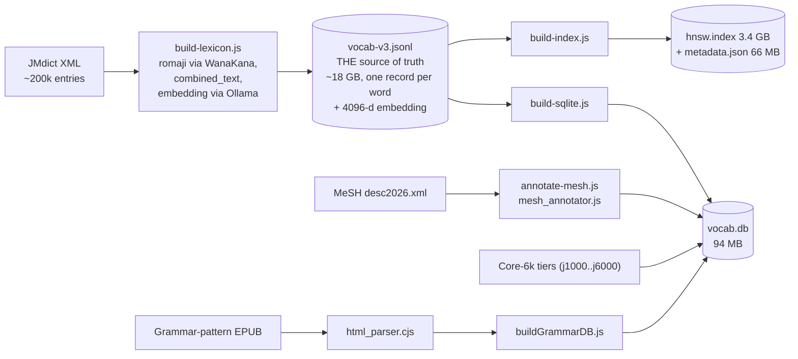
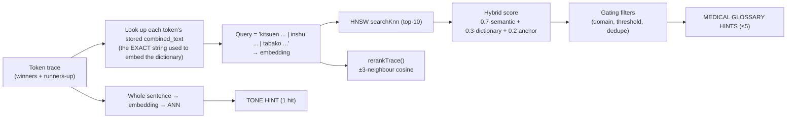
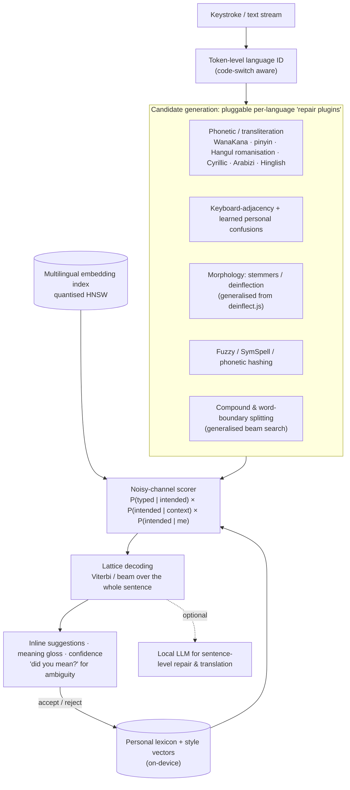

<div align="center">

# 🏥 med-jp

### A local, privacy-first "broken-notes → meaning" engine for Japanese ⇄ English medical interpreting

*Take the half-spelled, half-heard, typed-in-a-hurry romaji of a Japanese patient's sentence, work out what was **actually said**, and hand a clean reconstruction to an LLM for translation.*

`Node.js (ESM)` · `WanaKana` · `Fuse.js` · `SQLite` · `HNSW (hnswlib)` · `Qwen3 embeddings (4096-d)` · `Ollama (local LLM)` · `JMdict` · `MeSH`

</div>

---

## Table of contents

1. [Why this exists](#1-why-this-exists-the-story)
2. [The big idea in one picture](#2-the-big-idea-in-one-picture)
3. [A worked example](#3-a-worked-example)
4. [Tech stack](#4-tech-stack)
5. [The data layer (what the system "knows")](#5-the-data-layer-what-the-system-knows)
6. [Deep dive: `preprocessor.js`, the candidate engine](#6-deep-dive-preprocessorjs-the-candidate-engine)
   - [6.1 Chunking and the fast path](#61-chunking-and-the-fast-path)
   - [6.2 Candidate generation: the variant factory](#62-candidate-generation-the-variant-factory)
   - [6.3 Three ways to match a variant](#63-three-ways-to-match-a-variant)
   - [6.4 Deinflection: un-conjugating verbs and adjectives](#64-deinflection-un-conjugating-verbs-and-adjectives)
   - [6.5 Scoring: one number to rank them all](#65-scoring-one-number-to-rank-them-all-linguisticsjs)
   - [6.6 The verb gate](#66-the-verb-gate)
   - [6.7 Chunking *inside* a word: beam search over hiragana](#67-segmentation-beam-search-over-hiragana)
   - [6.8 `buildHiraToRawMap`: never lose the original typo](#68-buildhiratorawmap-never-lose-the-original-typo)
   - [6.9 Grammar suffix peeling and token collapse](#69-grammar-suffix-peeling-and-token-collapse-grammarpeeljs)
   - [6.10 Semantic reranking in vector space](#610-semantic-reranking-in-vector-space-cosine-similarity)
7. [Embeddings, semantic space and RAG](#7-embeddings-semantic-space-and-rag)
8. [Prompt construction and the local LLM](#8-prompt-construction-and-the-local-llm)
9. [MeSH ontology annotation](#9-mesh-ontology-annotation-teaching-the-dictionary-what-is-medical)
10. [Evaluation harness and honest results](#10-evaluation-harness-and-honest-results)
11. [Running it](#11-running-it)
12. [Project layout](#12-project-layout)
13. [What I learned](#13-what-i-learned)
14. [Known issues and next fixes](#14-known-issues-and-next-fixes)
15. [The dream version: an "ultimate autocomplete" for multilingual people](#15-the-dream-version-an-ultimate-autocomplete-for-multilingual-people)
16. [Data sources and credits](#16-data-sources-and-credits)

---

## 1. Why this exists (the story)

I set out to become a **Japanese ⇄ English medical interpreter**. The job is simple to describe and brutal to do:

> A Japanese-speaking patient talks. I listen, take notes, and then render what they said to an English-speaking doctor. And the other way around.

The problem is **speed**. Spoken Japanese is fast, and its grammar stacks endings on endings (`tabe-rare-nakatta`, "was not able to eat"). By the time I had written down one clause the patient was two clauses ahead. My notes were never clean. They looked like this:

```
kitsueninshu tabako ha arimasu ka
shuinbun wo yondari miru koto shuuchu dekimasen ka
hoka no hito ni ugoitari hanshitari no ga osokute kitdukaremashitaka
```

These notes are typed in romaji, with missing vowels, swapped letters, doubled or dropped consonants, non-standard spellings (`jya`, `kudasi`, `ijyou`), particles glued to nouns, and several words fused into a single string. Feeding that straight to a translator, or even straight to an LLM, produces confident nonsense. A model will happily turn `shinda hou ga mashi` ("I'd be better off dead") into a sentence about the subway. In a medical setting, that is not a harmless failure.

So I built a pipeline that does what a good interpreter does in their head: **look at a mangled fragment, consider every plausible thing it could have been, weigh each against what is linguistically and medically likely, and use the surrounding context to pick the winner.** Only then is the LLM asked to translate.

It runs **100% locally** (Ollama + a local vector index + SQLite), because patient information should never leave the machine.

> ⚠️ **Disclaimer.** This is a personal engineering and learning project, not a certified medical interpreting tool. It must never replace a qualified human interpreter. See [Known issues](#14-known-issues-and-next-fixes) for failure cases, including one safety-relevant one.

---

## 2. The big idea in one picture

The system has **three phases**: *generate* many hypotheses, *score* them, *select* the winners. Then it **augments** the final prompt with retrieved knowledge (RAG).

```mermaid
flowchart TD
    A["Raw broken romaji<br/>e.g. 'kitsueninshu tabako arimasu ka'"] --> B["Chunking<br/>split on spaces / punctuation"]
    B --> C{"Whole chunk<br/>confident? (score greater than 1100)"}
    C -- yes --> Z["Accept token"]
    C -- no --> D{"Strong verb<br/>legality gate?"}
    D -- yes --> Z
    D -- no --> E["Segmentation beam search<br/>over hiragana"]

    subgraph GEN ["1 · CANDIDATE GENERATION (per segment)"]
        G1["Original text"]
        G2["WanaKana round-trip normalisation"]
        G3["Corruption repair<br/>insert a/i/u/e/o after stuck consonants"]
        G4["Consonant doubling<br/>k s t p c n"]
        G5["Dakuten / phonetic swap<br/>k↔g s↔z t↔d h↔b"]
        G6["Fuzzy search (Fuse.js)"]
        G7["Deinflection<br/>v1 / v5 / vk / vs / adj-i"]
        G8["Grammar-suffix peel<br/>から たり ように ..."]
        G9["Particle map"]
    end

    E --> GEN
    GEN --> S["2 · SCORING (linguistics.js)<br/>match tier + frequency + JMdict priority<br/>+ medical domain − typo − length penalties"]
    S --> SEL["3 · SELECTION<br/>Viterbi-style cost minimisation<br/>keep top-3 paths per position"]
    SEL --> Z
    Z --> H["Grammar collapse + orphan merge<br/>(across token boundaries)"]
    H --> R["Semantic rerank<br/>cosine similarity vs ±3 neighbour vectors<br/>(HNSW index, 4096-d)"]
    R --> Q["RAG<br/>embed winners → ANN search → glossary + tone hints"]
    Q --> P["Prompt builder<br/>few-shot + glossary + tone"]
    P --> L["Local LLM (Ollama, Qwen3.5)<br/>literal first-person translation"]
```



The important design stance, visible throughout the code, is **deterministic first, semantic second**. Cheap, explainable, rule-based methods generate and prune candidates. Embeddings then arbitrate between the survivors, instead of being asked to magically solve everything.

---

## 3. A worked example

These come from real runs in `pipeline.log` and my [`eval/cases.json`](eval/cases.json) suite.

### 3.1 `kitsueninshu` → *smoking* + *drinking*

The patient was asked about smoking and alcohol; I typed `kitsueninshu` (喫煙 `kitsuen` + 飲酒 `inshu`) as one blob.

1. The whole chunk matches nothing confidently, so it goes to **beam search**.
2. WanaKana reads the romaji greedily. `n` + `i` becomes **に**, so the hiragana string is `きつえにんしゅ`. The word boundary I meant (`kitsuen|inshu`) is *invisible* in hiragana. This is the classic Japanese **"n" ambiguity** (`kin'en` vs `kinen`).
3. The beam search explores segmentations and costs each one. Using [`buildHiraToRawMap`](#68-buildhiratorawmap-never-lose-the-original-typo), each hiragana segment is mapped back to the **original raw romaji**, so the matcher sees `kitsue` and `ninshu`, not an already-normalised string. Fuzzy matching and repair then recover **`kitsuen`** and **`inshu`**.

```text
[BeamSearch] kitsueninshu
  hiragana:   きつえにんしゅ
  final_cost: 4928
  segments:   きつえ → kitsuen   |   にんしゅ → inshu
  rejected:   きつえにんしゅ (whole, passthrough)  cost 7665
              きつえに|んしゅ                       cost 10914
```

The winning path is **~2,700 cost units cheaper** than "give up and pass the string through". The RAG stage then sees `kitsuen`, `inshu`, `tabako` and injects their glossary entries.

### 3.2 `taberarenakatta` → one verb, three layers

`taberarenakatta` is `tabe` + `rare` (potential) + `nakat` (negative) + `ta` (past): "was not able to eat". The **verb gate** (§6.6) un-conjugates it in three steps back to **`taberu`**:

```text
[Verb Gate Triggered] "taberarenakatta" -> "taberu" (variant: "taberarenakatta", steps: 3, dist: 0.00)
```

### 3.3 More small repairs, straight from the logs

| Typed | Mechanism | Repaired / resolved |
|---|---|---|
| `okiagru` | **Vowel insertion** (corruption repair) | `okiagaru` |
| `hanou` | **Consonant doubling** | `hannou` (反応, "reaction") |
| `ijyou`, `senjyutsu` | **WanaKana round trip** (`jyu→じゅ→ju`) | `ijou`, `senjutsu` |
| `waruknai` | Repair + deinflect | `warukunai` → `warui` (negative) |
| `shimaimsu` | Repair + deinflect | `shimaimasu` → `shimau` |
| `kaettekite` | Deinflect (te-form + `kuru`) | `kaettekuru` |

---

## 4. Tech stack

| Layer | Technology | Role |
|---|---|---|
| Runtime | **Node.js (ES modules)**, run with `--max-old-space-size=6144` | Whole pipeline is JavaScript |
| Romaji ⇄ kana | **WanaKana** | Round-trip normalisation, corruption detection, hiragana segmentation |
| Fuzzy matching | **Fuse.js** | Typo-tolerant lookup over ~romaji vocabulary |
| Structured store | **SQLite** via `better-sqlite3` | 204,561-row vocabulary DB, grammar tables, MeSH annotations |
| Vector index | **hnswlib-node** (HNSW, cosine) | Approximate-nearest-neighbour search *and* O(1) vector retrieval for 204,560 words |
| Embeddings | **`qwen3-embedding`** via Ollama (**4096 dimensions**) | Semantic space for words and sentences |
| LLM | **Qwen3.5** via Ollama (custom `Modelfile`, temperature 0) | Final literal translation |
| Dictionary | **JMdict** (parsed with `fast-xml-parser`) | Vocabulary, POS tags, priority labels, glosses |
| Ontology | **MeSH 2026** descriptors | Tags words as disease / drug / anatomy / procedure… |
| Grammar | A Japanese sentence-pattern dictionary (EPUB → `cheerio` → JSON → SQLite) | 884 grammar patterns, 1,086 anchors |
| Frequency | "Core 6k" tiered word list (`xlsx`) | `j1000 … j6000` frequency tiers |
| Tooling | `dotenv`, custom logger, evaluation harness | Reproducible traces and Markdown/JSON reports |

---

## 5. The data layer (what the system "knows")

A large part of the project was **building the knowledge base** the engine reasons over. The offline pipeline looks like this:



### The JSONL is the real database

[`data/vocab-v3.jsonl`](scripts/build/build-lexicon.js) is the **canonical store**: one JSON object per dictionary word, including its full 4096-float embedding. Everything else is *derived* from it:

- **`vocab.db`** (SQLite): everything *except* the embedding, so lookups stay small and fast.
- **`hnsw.index` + `metadata.json`**: the embeddings (compiled into an ANN graph) plus the lightweight text metadata keyed by index label.

This split exists because **the embeddings are enormous**. 204,560 words × 4,096 dims × 4 bytes ≈ **3.35 GB** of raw floats, and **18 GB** as JSON text. Holding them as JavaScript arrays caused out-of-memory failures (an earlier iteration, [`hybridSearch.js`](src/hybridSearch.js), did brute-force cosine search over `Float32Array` data and the comment trail shows the OOM pain). Moving them into hnswlib's native memory solved it.

### What each artefact holds

| Artefact | Size | Contents | Why it exists |
|---|---|---|---|
| `vocab-v3.jsonl` | ~18 GB | Romaji, kana, kanji, meanings, POS, domain, tags, frequency, `combinedText`, **embedding** | Resumable build output: the canonical record |
| `vocab.db` | 94 MB | 204,561 rows; `romaji`, `pos`, `tags`, `freq`, `domain`, `combined_text`, `mesh_domains`, `common_words` + grammar tables | Fast structured lookups, no vectors |
| `hnsw.index` | 3.4 GB | HNSW graph over 204,560 vectors (cosine, 4096-d) | ANN search **and** `getPoint(label)` vector retrieval in memory |
| `metadata.json` | 66 MB | `label → {romaji, meanings, pos, domain, tags, frequency, combinedText}` | Text for ANN hits without touching SQLite |
| `mesh_annotations.json` | 3.7 MB | Per-entry MeSH matches with confidence | Audit trail of ontology tagging |

### The embedding recipe: `combined_text`

An embedding is only as good as the text you embed. For every word I construct a *descriptive* string, not just the word itself:

```text
kokain 古加涅 (コカイン) type: noun domain: pharmacology meanings: cocaine
```

*(format: `romaji kanji (kana) type: POS domain: field meanings: top-4 glosses`)*

Embedding the romaji, kanji, kana, part of speech, domain and glosses together puts a word in a region of vector space where **meaning, not spelling**, determines its neighbours. `kusuri` (medicine) lands near `shohousen` (prescription) and `nomigusuri` (oral medication), even though they share no characters.

### Scoring ingredients stored per word

- **Frequency tier**: from the Core-6k list (`j1000` highest … `j6000`), tagged on 5,816 entries. Otherwise falls back to JMdict `nfNN` frequency bands.
- **JMdict priority labels**: `ichi1`, `news1`, `spec1`.
- **Domain**: JMdict `<field>` tags (29,305 entries carry one) plus **MeSH domains** (8,793 entries).

---

## 6. Deep dive: `preprocessor.js`, the candidate engine

[`src/preprocessor.js`](src/preprocessor.js) is the heart of the project. It turns *one noisy token string* into a **ranked list of dictionary hypotheses** and decides which segmentation of the whole string is most plausible.

At module load it:

1. Opens `vocab.db`, loads all 204k entries into an in-memory **`exactMatchIndex`** (`Map<romaji, entry[]>`).
2. Builds a **Fuse.js** index over the romaji of medically tagged or reasonably frequent words.
3. Loads the grammar anchor table ([`grammarPeel.js`](src/grammarPeel.js)).
4. Exposes `preprocessJapTrace()` and `rerankTrace()`.

### 6.1 Chunking and the fast path

`dispatch()` splits input on whitespace and punctuation (`[.。?？!！,、\s]`) and resolves each chunk independently. This is why [`romaji-guide.md`](romaji-guide.md) tells the user to put spaces between particles and words. Explicit boundaries massively shrink the search space.

`resolveChunk()` then tries, in order of cost:

1. **Whole-chunk evaluation.** If the best candidate scores **> 1100** (an exact dictionary hit with decent frequency), accept immediately.
2. **The strong-verb gate** (§6.6).
3. **Beam search segmentation** (§6.7).

Particles (`wa/ha → は`, `ga → が`, `o/wo → を`, `ni`, `e`, `to`, `de`, `no`, `mo`, `ka`, `ya`, `yo`, `ne`) are handled deterministically by the **`PARTICLE_MAP`**. They are tiny, extremely ambiguous strings (`o`, `e`, `ka`) that fuzzy matching would only ever mangle, so they are resolved by lookup *before* any variant generation. Note `ha → wa` (pronunciation) and `o → wo` (spelling).

### 6.2 Candidate generation: the variant factory

`generateVariants(chunk)` produces a `Map` of **alternate spellings** of the input, each tagged with *how* it was produced. The tag later changes how heavily the variant is penalised. Every one of these represents a hypothesis about **how the notes got corrupted**:

| # | Variant | Hypothesis about the error | Mechanism |
|---|---|---|---|
| 0 | **Original** | The notes are right | Used as typed |
| 1 | **Corruption repair** | I dropped a vowel | `toHiragana(chunk)` and check whether any `[a-z]` survived (**corruption detection**). If romaji letters are *stuck* in the hiragana, find the exact position and try inserting each of `a i u e o` after the stuck cluster |
| 2 | **Consonant doubling** | I dropped a geminate (っ) or a ん | For each of `k s t p c n` followed by a vowel/`y`, double it (`hanou → hannou`, `kite → kitte`) |
| 3 | **Dakuten / phonetic swap** | I mixed voiced and unvoiced sounds | Swap `k↔g s↔z t↔d h↔b f→b z→s d→t b→h`, one position at a time |
| 4 | **WanaKana round-trip** | I used a non-Hepburn spelling | `romaji → hiragana → romaji` collapses `si/shi`, `tu/tsu`, `zi/ji`, `jya/ja`, `ou/oo` variants into the canonical Hepburn form the dictionary was built with |

**Corruption detection** is one of the neatest tricks. Converting a *correctly typed* romaji string to hiragana leaves **zero** Latin letters. So *any* leftover Latin letter is a precise fingerprint of an error and also tells you **where**:

```js
const hiraganaRaw = wanakana.toHiragana('okiagru');   // 'おきあgる'
const hasCorruption = /[a-z]/.test(hiraganaRaw);       // true → the 'g' is orphaned
// → locate it, then try okiaga-ru, okiagi-ru, okiagu-ru, okiage-ru, okiago-ru
```

Locating the error position in the *original romaji* (not the hiragana) is non-trivial, because the two strings have different lengths and alignments. That alignment problem is exactly what led to `buildHiraToRawMap` (§6.8).

### 6.3 Three ways to match a variant

Each variant is evaluated by `evaluateVariants()` through up to three matchers, with the **match type recorded** (`exact`, `exact:repair`, `exact:doubling`, `exact:phonetic`, `normalized`, `fuzzy`, `deinflect:fuzzy_stem`, …):

1. **Exact.** `Map.get(variant)` against the in-memory index: O(1). If any exact hit scores above 1100 the variant loop **short-circuits**: no point searching further.
2. **Fuzzy.** Fuse.js (`threshold 0.3`, `distance 50`, `minMatchCharLength 2`), top-5 hits, skipped for strings longer than 25 characters. The Fuse distance is carried forward into the score as a **typo penalty**.
3. **Deinflect.** Convert to hiragana, run the deinflector (§6.4), then look the *dictionary form* up exactly, or fuzzily as a *fuzzy stem*, and keep only the candidates whose **part of speech is compatible** with the inflection rule.

All candidates are pooled, sorted by score, **de-duplicated by dictionary ID**, and the top 5 logged. A final safeguard clamps non-exact candidates beneath a legitimate common exact match (a guard I left a comment on, wanting the semantic layer to eventually make it unnecessary).

If the best candidate scores under **600**, the chunk becomes a **passthrough** (`passthrough:low_confidence`). The system would rather say "I don't know" and forward the raw text than hallucinate a dictionary word.

### 6.4 Deinflection: un-conjugating verbs and adjectives

A dictionary stores `taberu`. People say `tabeta`, `tabenai`, `taberarenakatta`, `tabesasetai`, `tabechatta`. [`src/deinflect.js`](src/deinflect.js) is a **rule-table deinflection engine** (the design follows the approach used by popup-dictionary tools). Each rule says:

```
[ from-ending, to-ending, fromType, toType, [reasons...], weight ]
['かった',  'い', Initial, IAdj, [Past], 1.0]   // …katta   → …i    (past tense)
['ければ',  'い', Initial, IAdj, [Ba],   1.0]   // …kereba  → …i    (conditional)
['ませんでした', '', Initial, MasuStem, [PolitePastNegative], 1.0]   // …masen deshita → masu-stem
```

- Rules are grouped **longest-ending first** and applied breadth-first, so multi-layer conjugations (`tabe + rare + nakat + ta`) unwind **one layer at a time**, with a **reason chain** recorded at each step (`Potential → Negative → Past`). Those chains become human-readable **grammar tags** (`"Potential / Passive"`, `"Negative"`, `"Past tense"`) that flow through to the trace.
- Word types are **bit flags** (`IchidanVerb`, `GodanVerb`, `KuruVerb`, `SuruVerb`, `IAdj`, plus intermediate stem types like `MasuStem`, `TaTeStem`, `IrrealisStem`). A rule can only fire when the current type matches its `fromType`, which is what prevents nonsense chains.
- Rules can carry a **weight** below 1.0 to demote ambiguous one-kana endings.

**Using the dictionary's POS tags as a legality check.** This is the clever bit. A deinflection like `waktta → waku` is only *valid* if the dictionary entry for `waku` is actually a verb of the right class. `mapPosToVerbClass()` translates JMdict POS tags into the same bitmask:

| JMdict tag | → word type |
|---|---|
| `v1` | Ichidan (ru-verb) |
| `v5*` (`v5k`, `v5r`, …) | Godan (u-verb) |
| `vk` | *kuru* (irregular) |
| `vs`, `vz` | *suru* verbs / verbal nouns |
| `adj-i` | i-adjective |

```js
const isMatch = (mapPosToVerbClass(wordData.pos) & c.type) !== 0;
if (!isMatch) continue;     // the candidate root must be the right KIND of word for this inflection
```

So the grammar engine proposes, and the **dictionary vetoes**.

There is also an experimental `getCanonicalSuffixes()` which BFS-expands the rule table (depth ≤ 3) into every legal verb-ending string, and a reversed-suffix Fuse index meant for typo-tolerant ending recognition.

### 6.5 Scoring: one number to rank them all (`linguistics.js`)

[`src/config/linguistics.js`](src/config/linguistics.js) defines **one canonical scoring function** used everywhere: the preprocessor, the ANN search, and even the offline lexicon builder. Every candidate gets a score built in three stages:

```text
STAGE 1  Lexical desirability   (is this a word I'd expect to hear?)
   lexical = frequency  (Core-6k tier: 100,90,80…  or  100 − 2·nfBand)
           + priority   (ichi1 +40, news1 +30, spec1 +50)
           + semantic   (medical domain: mesh_disease 100, mesh_drug 90, pharmacology 80,
                         mesh_psychiatric 80, mesh_diagnostic 75, mesh_procedure 70,
                         medicine 60, anatomy 40; strongest + 5 per extra tag)

STAGE 2  Match reliability      (how did I find it, how far off was it?)
   tier  = EXACT 1000 | GRAMMAR_PEEL 980 | NORMALIZED 950 | DEINFLECT 950
           | FUZZY 800 | AGGRESSIVE 400
           (− 50 repair · − 100 phonetic swap · − 100 doubling · − 50 non-original fuzzy)
   decay          = max(0, 1 − (3·distance)²)
   typoPenalty    = distance² · 250 · 5
   lengthPenalty  = 80 · |inputLen − matchLen|      (not applied to deinflections)
   confidence     = tier + lexical·decay − typoPenalty − lengthPenalty

STAGE 3  Segmentation fitness   (only inside beam search)
   exact-match bonus   400 + 50·len        (non-exact: −(200 + 300/len))
   whole-word bonus    150 · log2(len+1)   (anti-fragmentation)
   stability bonus     (stability − 0.75) · 400
   tiny-fragment penalty  −500             (1-char non-exact)
```

Two design points worth highlighting:

- **Frequency is multiplied by `decay`.** A *very* common word that is a poor spelling match gets little credit. A rare word that is an exact match keeps all of it.
- **Medical domain weight lets context resolve homophones.** `zensoku` is both "full speed" and "**asthma**". The MeSH-derived `mesh_disease` weight (+100) is what makes it `asthma` in a clinic.

Real scores from the evaluation logs: `kusuri` ("medicine") = **1170** (1000 exact + 170 lexical); the bogus fuzzy neighbour `ikikata` = **719**.

### 6.6 The verb gate

Before paying for a beam search, `detectStrongVerbMatch()` asks: *is this whole chunk a single legitimately conjugated verb?* It tries all variants through the deinflector and only fires if **all** hold:

```js
grammar.isValidClassMatch      // dictionary POS agrees with the rule
&& grammar.ruleWeight >= 0.8   // the rule isn't an ambiguous 1-kana one
&& grammar.fuzzyStemDistance <= 0.12   // the stem is a near-exact dictionary hit
```

This catches long agglutinated verbs (`taberarenakatta`, `sesshushiteimasu`) that segmentation would otherwise shred into pieces.

### 6.7 Segmentation: beam search over hiragana

When a chunk is several words fused together (`kitsueninshu`), the engine has to find *where the word boundaries are*. This is the classic **word-segmentation** problem, and I solved it with a **Viterbi-style dynamic program with a beam**:

```text
topPaths[i] = the 3 cheapest ways to explain the first i hiragana characters

for each end position i:
   for each start position j in [i−25, i):
       for each way to explain hiragana[j:i]:        ← evaluatePrefix()
           for each of the 3 best paths ending at j:
               candidate path = path + segment,  cost = path.cost + segment.cost
   keep the 3 lowest-cost candidates for position i
```

The **cost model** turns scores into costs. Cheaper is better:

| Segment kind | Cost |
|---|---|
| Confident dictionary match | `(4500 − score) + SHORT_PENALTY + 150` |
| Particle | `100 + SHORT_PENALTY` |
| Grammar-peel compound | `max(0, 2000 − stemScore) − 150 − 10·priority (+ fuzzy distance·100)` |
| **Passthrough** (fallback, always available) | `8000 − 50·len` |

Because passthrough is always available but *very* expensive, the search never gets stuck, and it only chooses it when no combination of real words is cheaper.

Efficiency tricks:

- **Memoisation** of every `(hiragana, romaji)` segment evaluation in `globalEvalCache`.
- Segments **under 3 kana** are skipped (they'd be noise generators).
- Segments **ending in a bare consonant** (other than `n`) are skipped. They can't be real mid-word syllable boundaries.
- Max segment length 25 kana; beam width 3.
- Rejected paths are kept in `topPaths` and printed in traces, which makes debugging segmentation decisions much easier.

### 6.8 `buildHiraToRawMap`: never lose the original typo

Beam search works in **hiragana space** (where syllable boundaries are well-defined), but the *matchers* need to look at what I **actually typed** (because typos live in the raw romaji). The two strings don't align one-to-one: `shi` is three letters but one kana, `kk` is one `っ`.

```js
function buildHiraToRawMap(rawChunk, hiraChunk) {
  const hiraToRaw = new Uint8Array(hiraChunk.length + 1);
  let hIdx = 0;
  for (let rIdx = 0; rIdx < rawChunk.length; rIdx++) {
    const subH = wanakana.toHiragana(rawChunk.slice(0, rIdx + 1));   // convert growing prefix
    while (hIdx < subH.length) { hiraToRaw[hIdx] = rIdx; hIdx++; }   // newly emitted kana ↔ this raw index
  }
  hiraToRaw[hiraChunk.length] = rawChunk.length - 1;
  return hiraToRaw;
}
```

It converts progressively longer prefixes of the raw string and records **at which raw letter each hiragana character first appeared**. Then `evaluatePrefix()` can take a hiragana window `[j, i)` and slice the exact original romaji out of `rawChunk`. The segmentation is chosen in clean kana-space, but the *evidence* each segment is judged on is the user's original, untouched spelling, repairs and all.

### 6.9 Grammar suffix peeling and token collapse (`grammarPeel.js`)

Beyond verbs and nouns, Japanese is full of **grammatical glue**: から, たり, ように, ばかり, ながら. A typo'd noun with a correct suffix (`gakkoukara`) is easy to explain if you can **strip the suffix and match the stem**.

[`grammarPeel.js`](src/grammarPeel.js) loads **817 unique grammar-ending anchors** (from a sentence-pattern dictionary I parsed into SQLite) into a hash map keyed by hiragana, indexed longest-first (max length 11). It runs in two phases:

**Phase 1: suffix peel (inside the beam search).** For each candidate segment, try peeling every known anchor off the end (longest first). If the remaining *stem* matches the dictionary (exactly, or via fuzzy "stem repair" when the anchor is strong but the stem is corrupted), emit a **compound candidate**: stem + grammar meaning. Single-kana anchors that collide with particles and verb endings (`お か が け ご し た だ つ て で と な に は ば も や を`) are blacklisted as too ambiguous.

**Phase 2: collapse and orphan merge (after beam search, across whitespace).** Because I type with spaces in odd places:

- *Pass 1, multi-token pattern detection.* Slide a window of 2-4 tokens, concatenate their surfaces, and check whether the string **starts with a grammar anchor**. It only acts if at least one token in the window is low-confidence garbage, so already-correct parses aren't disturbed.
- *Pass 2, orphan merge.* If a token is garbage, glue it to its left neighbour and **re-run the whole segmenter**. The merge is accepted only if the new score is **> 20% better** *and* doesn't itself contain garbage.

### 6.10 Semantic reranking in vector space (cosine similarity)

Everything so far is *spelling and grammar*. But `kitsuen` ("smoking") vs `kotsuen` ("osteitis") is a coin-flip on spelling and an easy call on **meaning**, if the surrounding words are `inshu` (drinking) and `tabako` (tobacco).

`rerankTrace()` is the semantic arbiter:

1. For every token, take the HNSW vector of its **current winner**.
2. For each token, build a **context vector** = the average of the winning vectors of the **±3 neighbouring tokens**, blended with the **sentence-level query embedding**.
3. For each of the token's candidates, compute **cosine similarity** between the candidate's vector and that context vector.
4. Convert similarity into a score **boost**, shaped by an *empirical noise floor*:

```js
// cosine similarity: dot(a,b) / (|a|·|b|)  → 1.0 same direction, 0 unrelated
if (cosSim > 0.60) {                          // below ~0.55 is noise for this model
  ratio = Math.min(1.0, (cosSim - 0.60) / 0.15);
  rawBoost = MAX_BOOST * ratio;               // MAX_BOOST = 450
  semanticBoost = rawBoost * Math.max(0, 1 - distance * 3);   // bad spellings earn less
}
```

5. **Protection rules** stop the semantic layer from hallucinating. If the current winner is an exact match or a confident deinflection, a *different* candidate must reach **cosine ≥ 0.95** to overtake it, and loose fuzzy candidates lose their boost entirely. The comment in the code records the incident that motivated it: `arimasuka → himatsukaku`.

A key subtlety (documented in the code): the neighbours' vectors and the candidate's vectors **come from the same HNSW index**, so their cosine similarities live in the *same vector space* and are directly comparable. An earlier version compared word vectors to a sentence embedding. Those are different distributions of the space, so the numbers weren't meaningful.

When a candidate overtakes the incumbent the engine logs a "⭐ FLIP TRIGGERED" with old/new cosines and boost.

---

## 7. Embeddings, semantic space and RAG

### What is an embedding / semantic space?

An embedding model maps text to a point in a high-dimensional space (here **4096 dimensions**) such that *texts with similar meaning are close together*. **Cosine similarity** measures the angle between two such vectors: `1` = same direction (same meaning), `~0` = unrelated.

This gives me something spelling-based methods can never offer: a way to ask *"which candidate makes this sentence make sense?"*

### Where embeddings are used in the pipeline



**The "same embedding space" trick.** An early version embedded bare romaji (`"kokain kiraku nando"`). That produced weak matches because the *dictionary* was embedded as rich `combined_text`. The fix: the query is built from the **stored `combined_text` of each token's top-2 candidates**, i.e. the exact same kind of string the index contains, so query and corpus live in the same region of the space.

**Hybrid scoring** (`load-index.js → searchANN`):

```text
semanticScore = 1 − distance/2                      (maps cosine distance onto [0,1])
final = 0.7·semanticScore + 0.3·(lexical/1000) + 0.20·[word appears in the user's own tokens]
```

Semantic similarity leads (70%); dictionary evidence (frequency/priority/domain) is the tie-breaker (30%); and a word the user actually typed gets an **anchor bonus**.

**Relevance gating** (`promptBuilder.js`) decides what's allowed to reach the LLM:

| Hit type | Rule |
|---|---|
| Direct dictionary hit that is medical | always kept |
| Clinical-domain ANN hit | keep if semantic ≥ 0.40 |
| Very common word (`nf01–03`) | blocked unless semantic ≥ 0.90 (don't explain "to be" to the LLM) |
| Other | keep if semantic ≥ 0.92, or ≥ 0.85 *and* it overlaps a typed token |
| After filtering | de-dupe by primary meaning (no `but / however / although` flooding), keep ≤ 5 |

Query tokens also go through a **POS filter** (`GRAM_POS`: particles, copulas, auxiliaries, conjunctions…) so grammar words don't drown out clinical content, and medical-domain tokens are prioritised.

**Two parallel embeddings** run concurrently: the *medical* query (`combined_text` of candidates → glossary hints) and a *tone* query (the whole sentence → one pragmatic "tone hint").

### Why HNSW (and the `hnsw.index` ↔ database mapping)

Brute-force cosine over 204,560 × 4096 floats works but is slow, and holding 3.4 GB of vectors as JS arrays blows the heap. **HNSW** (Hierarchical Navigable Small World graphs) gives:

- **Sub-linear approximate nearest-neighbour search** over the whole vocabulary.
- **`getPoint(label)`**: constant-time retrieval of any stored vector, so `rerankTrace` can fetch neighbour and candidate vectors on demand with no second copy in RAM.
- A **native binary** loaded with `readIndexSync`: fast boot, no JSON parsing.

The index is a *label → vector* structure; [`metadata.json`](scripts/build/build-index.js) is the *label → word* map, and `vocab.db` is the *word → everything-else* store. Together, these three files map **vocabulary in the database ⇄ vocabulary with an embedding**, held in memory for fast access. (A caveat about how the labels line up with database IDs is in [§14](#14-known-issues-and-next-fixes).)

---

## 8. Prompt construction and the local LLM

The winning tokens (`preprocessedInput`), the retrieved **glossary hints**, and the **tone hint** are assembled by [`promptBuilder.js`](src/promptBuilder.js) into a few-shot prompt:

```text
TASK: Translate the following Japanese (romaji) dialogue into natural English.
You are an interpreter. The speaker may be a Japanese patient describing symptoms or a doctor asking screening questions.

RULES:
- Use FIRST PERSON ("I", "my", "I feel") when the speaker is a patient.
- Use natural medical questioning ("Have you...", "Do you feel...") when the speaker is a doctor.
- Translate faithfully. Do NOT add information that is not present.
- If input is unnatural or fragmented, reconstruct into natural English meaning using standard Japanese grammar.
- CLINICAL PRIORITY: If a term is ambiguous, prioritize the most clinical or medical interpretation.
- Output ONLY the English sentence.

EXAMPLES: ...

MEDICAL GLOSSARY HINTS:
- kitsuen: smoking tobacco
- inshu: drinking alcohol
TONE HINT:
- ...

Input: kitsuen inshu tabako arimasu
Output: /no_think
```

- **Model.** [`modelfile/Modelfile`](modelfile/Modelfile) builds `med-interpreter` on `qwen3.5`: `temperature 0`, `top_p 0.1`, `repeat_penalty 1.1`, and a system prompt demanding a **literal, first-person** translation ("I have…", never "The patient reports…") with no summarising or diagnosing.
- **Streaming.** [`ollamaClient.js`](src/ollamaClient.js) consumes Ollama's NDJSON stream; [`interpreter.js`](src/interpreter.js) is an `async function*` that yields chunks as they arrive, and a small readline REPL ([`index.js`](src/index.js)) prints them live.
- **Two directions.** `JAP:` runs the whole pipeline above. `ENG:` (English → formal clinical Japanese with furigana for rare kanji) uses a lighter path: normalisation plus a few-shot template. The glossary hooks exist there but aren't injected yet.
- **Observability.** Every stage writes to [`pipeline.log`](src/logger.js) via a global console intercept, including token traces, per-candidate score breakdowns (`[exact: 1000] [Lex: +170] [Typo: -2] [Len: -80]`), RAG filter decisions, timings and the final prompt.

---

## 9. MeSH ontology annotation: teaching the dictionary what is "medical"

JMdict only tags ~29k of 204k entries with a field. To give the scorer a richer notion of *"clinically relevant"*, I annotated vocabulary against the **MeSH 2026 descriptor set** ([`mesh_parser.js`](src/mesh_parser.js), [`mesh_annotator.js`](src/mesh_annotator.js), [`scripts/build/annotate-mesh.js`](scripts/build/annotate-mesh.js)):

- Parse MeSH into **inverted indexes** (`token → descriptors`) plus descriptor metadata (tree numbers, synonyms).
- Match each word's **primary English gloss** (secondary glosses were too noisy: `pacifier` falsely matched a MeSH medical device) in two phases:
  - **Phase 1, exact:** full gloss equals a MeSH preferred term or synonym. Accepted immediately (`asthma`).
  - **Phase 2, expansion:** token-level matches that must pass a graded **token-importance score** (length, ambiguity, katakana loanword signal, multi-token coherence, minus a penalty for weak / abstract / over-ambiguous tokens). Reject below 0.30; allow expansion at ≥ 0.50.
- **Multi-token coherence:** for glosses with ≥ 2 tokens, a descriptor must be supported by ≥ 2 of them (this blocks `colorado` matching *Colorado Tick Fever*; there's a test for exactly that).
- Map MeSH **tree numbers** to domains: `C → mesh_disease`, `D → mesh_drug`, `A → mesh_anatomy`, `E → mesh_procedure/diagnostic`, `F → mesh_psychiatric`…
- Confidence-score and keep only matches ≥ 0.70.

Result: **8,793** entries gain `mesh_domains`, which feed the `SCORING_WEIGHTS.SEMANTIC` table in §6.5. This is why `memai` (dizziness) is tagged `mesh_disease` and `zensoku` resolves to *asthma*.

---

## 10. Evaluation harness and honest results

Tuning a system with this many interacting heuristics by gut feel would have been hopeless, so I built an **evaluation harness** early ([`scripts/eval.js`](scripts/eval.js)):

- A suite of **15 real, messy cases** ([`eval/cases.json`](eval/cases.json)) taken from realistic interpreter-note styles: fused words, dropped vowels, wrong particles, drug/substance names in katakana-romaji (`marijuana cokain krauku`), mental-health screening questions, and long run-ons.
- For each case it records **everything**: per-token candidate decisions and score breakdowns, RAG hits, the injected glossary, the full prompt, the LLM output and per-stage timings, into timestamped **Markdown and JSON reports** in [`eval/`](eval/). There are dozens of runs, which let me diff behaviour after each change.
- Flags: `--no-llm` (retrieval and preprocessing only, fast), `--cases=id1,id2`.

### Sample results (run of 22 May, `eval/report-2026-05-22T14-08.md`)

| Input (broken romaji) | Output (excerpt) | Verdict |
|---|---|---|
| `sensei. konichi taicho yokunatta genki aru to demo omoimasu memai ga kibun warukute taberarenakatta` | "Teacher, today my physical condition improved and I feel okay, but I feel dizzy …" | ✅ Multi-layer verb + medical term recovered |
| `kitsueninshu tabako ha arimasu ka` | "I have a history of smoking tobacco." | 🟡 Smoking ✓, *alcohol dropped* |
| `genzai mata kako ni ikano jyoutai ni natta koto arimasu ka zensoku mansei heisoku haishikkan haien` | "…have I also had **asthma**, a chronic illness, pneumonia, o…" | ✅ `zensoku` → asthma (domain weight), `haien` → pneumonia |
| `marijuana cokain krauku nado sesshushiteimasu ka` | "Marijuana, cocaine, and crack; I have been vaccinated." | 🟡 Drugs ✓, but `sesshu` read as 接種 (inoculation) instead of 摂取 (ingestion): a **homophone** problem |
| `shindahouga mashi da to kangaetari …` | "I have been thinking about whether to take the subway…" | ❌ Missed the idiom 死んだほうがまし ("better off dead") |

The last row matters. It's a **suicidal-ideation screening question**, and the system got it dangerously wrong. This is the clearest argument for why the tool can only ever be *decision support for a human interpreter*, and the clearest roadmap item (idiom/pattern handling and a "low-confidence, ask me" signal).

**Performance.** The candidate engine is the bottleneck: ~3.3 s to resolve a three-chunk sentence (`kitsueninshu tabako arimasu`) on a laptop (many Fuse searches), while the 15-case suite with the local LLM took ~7 min. The 15 `--no-llm` cases finish far faster.

---

## 11. Running it

**Prerequisites:** Node.js 20+, [Ollama](https://ollama.com) with enough RAM for a ~3.4 GB index plus the LLM.

```bash
npm install

# Local models
ollama pull qwen3.5
ollama pull qwen3-embedding
npm run setup                       # builds the custom 'med-interpreter' model from modelfile/Modelfile

# .env (see .env)
# OLLAMA_BASE_URL=http://localhost:11434
# OLLAMA_MODEL=med-interpreter
# EMBED_MODEL=qwen3-embedding:latest
```

**Build the knowledge base** (the `data/` folder is git-ignored: it's ~22 GB of derived artefacts and third-party datasets):

```bash
node scripts/build/build-lexicon.js   # JMdict → romaji + combined_text + embeddings → data/vocab-v3.jsonl (resumable)
node scripts/build/build-sqlite.js    # JSONL → data/vocab.db
node scripts/build/build-index.js     # JSONL embeddings → data/hnsw.index + data/metadata.json
node scripts/build/annotate-mesh.js   # MeSH → mesh_annotations.json
node scripts/build/import-mesh.js     # write annotations into vocab.db
node src/buildGrammarDB.js            # grammar JSON → grammar / grammar_anchors tables
```

> The build scripts were moved into `scripts/build/` during refactors, so the `npm run build-*` aliases and some relative paths in `package.json` / the scripts need updating before they run unmodified. See §14.

**Interpret:**

```bash
npm start
> JAP: kitsueninshu tabako ha arimasu ka        # or the shortcut:  ± kitsueninshu tabako ha arimasu ka
> ENG: patient chest pain                        # or:               ! patient chest pain

npm run eval            # full suite with the LLM
npm run eval:quick      # retrieval + preprocessing only
npm run eval:case -- case-03-smoking-alcohol
```

**Typing tips** for best results are in [`romaji-guide.md`](romaji-guide.md): separate particles, don't smash agglutinative endings together, use `r` not `l`, break long sentences with punctuation.

---

## 12. Project layout

```text
med-jp/
├── src/
│   ├── index.js              CLI REPL (entry point)
│   ├── interpreter.js        async-generator orchestrator: build prompt → stream LLM
│   ├── promptBuilder.js      RAG assembly, relevance filters, prompt templates
│   ├── preprocessor.js       ★ candidate generation, scoring, beam search, semantic rerank
│   ├── deinflect.js          rule-table verb/adjective deinflection engine
│   ├── grammarPeel.js        grammar-suffix peel + multi-token collapse/merge
│   ├── load-index.js         HNSW + metadata loader, hybrid ANN scoring
│   ├── hybridSearch.js       earlier in-memory brute-force cosine engine
│   ├── ollamaClient.js       streaming client for Ollama /api/generate
│   ├── mesh_parser.js        MeSH XML → inverted indexes
│   ├── mesh_annotator.js     MeSH matching with graded token importance
│   ├── html_parser.cjs       grammar-dictionary EPUB → structured JSON (cheerio)
│   ├── buildGrammarDB.js     grammar JSON → SQLite tables
│   ├── logger.js             pipeline.log sections + console intercept
│   └── config/linguistics.js ★ the canonical scoring model and tag weights
├── scripts/                  eval harness + data build pipeline (build/…)
├── eval/                     cases.json + timestamped Markdown/JSON reports
├── modelfile/Modelfile       custom Ollama model (literal, first-person, temp 0)
├── romaji-guide.md           how to type notes for best results
└── data/                     (git-ignored) vocab-v3.jsonl, vocab.db, hnsw.index, metadata.json…
```

---

## 13. What I learned

**Embeddings and vector space**
- What an embedding *is*, and how **cosine similarity** measures meaning as angle in a 4096-d space. Also, crucially, that similarities are only comparable **within the same space** (neighbour-vs-candidate from the same index, not word-vs-sentence).
- **Embedding hygiene:** the text you embed matters. The `combined_text` recipe (romaji + kanji + kana + POS + domain + glosses) and "query in the same shape as the corpus" made retrieval dramatically better than embedding bare words.
- Establishing an empirical **noise floor** (cosine < ~0.55 is nothing) and shaping boosts above it instead of trusting raw similarity.
- **ANN indexing with HNSW**, why brute force doesn't scale in JS memory, and how a native index doubles as a vector store.
- **RAG design:** retrieval is only half the work. *Gating* (domain, thresholds, dedupe, POS filtering, anchors) decides what's safe to show an LLM.

**Deterministic NLP methods**
- **Fuzzy search** (Bitap/Fuse): thresholds, distance, and turning a distance into a calibrated penalty.
- **Chunking and segmentation:** whitespace/punctuation chunking, then **Viterbi-style beam search** with an explicit cost model, memoisation, pruning rules and always-available fallbacks.
- **WanaKana round-tripping** as a normaliser; **hiragana normalisation** so the whole engine speaks one canonical script.
- **Corruption detection:** a correctly spelled romaji string converts to hiragana with zero Latin letters left over, so leftover letters pinpoint errors and give a repair site.
- **Repair heuristics:** vowel insertion, consonant doubling, dakuten (voicing) swaps, and tagging each variant so it carries a different penalty.
- **Alignment bookkeeping:** `buildHiraToRawMap` keeping segmentation (kana-space) tied to evidence (raw-space).
- **Rule-based deinflection** with bit-flag word types, reason chains, and using JMdict's `v1 / v5* / vk / vs / adj-i` tags as a **legality oracle**.
- **Grammar suffix peeling** and cross-token collapse, plus an orphan-merge acceptance threshold.
- **Particle handling**, **frequency scoring** (tiered lists and JMdict priority), and an **ontology-derived** domain prior from MeSH.

**Engineering process**
- **Build the evaluation harness before tuning.** Reproducible, timestamped reports turned "feels better" into diffs.
- **Make decisions legible:** a `breakdown` string on every candidate (`[exact: 1000] [Lex: +170] [Typo: -2]`) made scoring bugs obvious.
- **Refactor the god-function** into stages (variant factory → evaluators → scorer → beam → rerank), which is what made the later beam-search and semantic-reranker rewrites possible.
- **Unify scoring in one module** used by the runtime, ANN search *and* the offline builder.
- **Resumable, streaming data pipelines** (JSONL append + resume, SQLite batched transactions) for multi-hour, multi-GB jobs.
- **Guard the semantic layer.** LLM/embedding components need protection rules (exact-match ceilings, high flip thresholds) or they confidently replace right answers with plausible wrong ones.
- **Local-first design** for sensitive data.

---

## 14. Known issues and next fixes

I'd rather document these honestly than hide them. They're good "next things to fix" for anyone reading the code:

1. **`vocab.db` ID ↔ HNSW label mismatch (important).** The lexicon builder embeds with 5 concurrent workers, so `vocab-v3.jsonl` is **not written in `entryId` order**. `build-index.js` assigns HNSW labels by *line order*, while `vocab.db` uses the JMdict `entryId`. Checking the artefacts, only **~20%** of `vocab.db` IDs equal the HNSW label for the same word. ANN search itself is unaffected (hits are read from `metadata.json` by label, which is self-consistent), but `rerankTrace()` calls `hnswIndex.getPoint(candidate.id)` with a `vocab.db` ID, which can fetch a *different word's* vector. **Fix:** build an `entryId → label` map from `metadata.json` at load time (a ~10-line change) or have `build-index.js` use `entryId` as the label. Related: `ragSearch` reads `item.id`, but metadata entries carry `entryId`, so the SQLite hydration step is currently skipped.
2. **Build scripts have drifted.** `package.json` aliases point at `scripts/build-*.js` but the files live in `scripts/build/`; relative `../data` paths in them now resolve incorrectly; and `build-lexicon.js` references `OLLAMA_URL` / `EMBED_MODEL` constants and a `fullDomainStr` variable that are not defined before use.
3. **Homophone and idiom failures** (`sesshu`, `shinda hou ga mashi`). Idioms need pattern-level handling, and the system needs a **calibrated "I'm not sure" signal** rather than a silent best guess.
4. **Short function words** (e.g. `desu` → *dezu* → `deru` via phonetic swap + verb gate) can still be over-eagerly rewritten; some of the ceiling/clamp heuristics are explicitly marked in the code as things the semantic layer should eventually replace.
5. **Latency.** Fuse searches dominate; a prefix trie / BK-tree / SymSpell-style deletion index over the vocabulary would be a large speed-up.
6. **ENG → JP** does not yet inject RAG glossary hints.
7. `Uint8Array` in `buildHiraToRawMap` assumes chunks shorter than 256 characters.

---

## 15. The dream version: an "ultimate autocomplete" for multilingual people

What I built is a very specialised instance of a much more general idea:

> **Given noisy, partial, personal text, infer the *intended meaning*, using the spelling as evidence rather than as ground truth.**

Every multilingual typist knows the pain: your phone's autocorrect declares your Portuguese word, your romaji, or your Japanese-English-Swedish sentence "misspelled" and *helpfully* destroys it. Language learners lack confidence in spelling. Dyslexic writers fight spellcheckers that only understand edit distance. A tool built on **embeddings and vector space** could instead ask the question the interpreter's brain asks: *"what could this have meant, given everything around it and everything I know about this writer?"*

### The vision

- **Language-agnostic.** Works across languages and scripts, and across *mixed* languages in the same sentence, with no "wrong language" red squiggles.
- **Personal.** Learns *your* vocabulary, nicknames, jargon, your recurring misspellings, your L1-interference patterns, and the way you write in each language, **on-device**.
- **Meaning-first.** Suggestions ranked by semantic fit, not just edit distance, with glosses shown in the language you think in.
- **Honest.** Shows several candidates with calibrated confidence, and asks when it truly isn't sure.

### How it would generalise this project's architecture



**1. Frame it as a noisy-channel model.** What `calculateCandidateScore` does heuristically (tier + frequency − typo − length) is a hand-tuned approximation of `P(typed | intended) × P(intended | context)`. The dream version makes the **channel model learnable** (from the user's own accept/reject history) and the **language model contextual** (embeddings, n-grams, or a small on-device LM).

**2. Pluggable "phonological repair" per language.** The variant factory (vowel insertion, doubling, voicing swaps, WanaKana round trip) is really *"the typical ways a writer corrupts this language"* encoded as code. Each language, or each *language pair* (English speaker writing Spanish; Japanese speaker writing English; Swedish speaker typing romaji), gets a plugin: pinyin tone-dropping, Hangul romanisation variants, Arabizi digit-letters (`3`, `7`, `5`), Hinglish, Cyrillic transliteration…

**3. Code-switching is a first-class citizen.** Run **per-token language identification**; instead of "this word isn't in the English dictionary → error", treat the sentence as a *lattice* in which each token can belong to any of the user's languages. The scorer decides.

**4. One multilingual semantic space.** Replace the single-language `combined_text` index with a **multilingual** embedding model so that `kusuri`, `medicine`, `medicina`, `läkemedel` and `薬` are *neighbours*. Then "what did I mean?" works across languages, and fuzzy intent recovery works even when the writer *doesn't know the spelling at all* but knows the meaning (type `kuz…ri` → medicine).

**5. Make the vectors small.** The 3.4 GB index here is a prototype's luxury. For a keyboard-sized product: use a model whose embeddings support **Matryoshka-style truncation** (Qwen3-Embedding supports flexible output dimensions) to cut 4096 → 256 dims, then **int8 / product quantisation**. 200k words × 256 dims at 1 byte is **~50 MB**, which fits on a phone. The retrieval pattern (ANN + `getPoint` for neighbour-averaged context vectors) transfers unchanged.

**6. Personalisation without surveillance.** Keep a **personal lexicon** (words you actually use, names, jargon) and a **style vector** (average embedding of your accepted text per language) *on the device*. Retrieval-augmented (kNN-LM-style) lookups over your own past writing bias suggestions toward *you*. Accept/reject signals update the channel model. Nothing leaves the machine, exactly as in this project.

**7. Calibrated uncertainty as UX.** The "passthrough" principle becomes a feature: *never silently rewrite what you can't justify*. Show `[a] medicine · [b] drug · [c] keep as typed`, and learn from the tap.

**8. Domain packs.** The MeSH idea generalises: **ontology-derived domain priors** (medical, legal, programming, culinary…) switchable per context, which is the difference between "asthma" and "full speed", and between `crack` and `crack cocaine`.

### A realistic roadmap

| Phase | Goal | Builds on |
|---|---|---|
| 1 | Extract a **language-agnostic core** (candidate lattice, noisy-channel scorer, beam decoder) from the Japanese specifics | `preprocessor.js`, `linguistics.js` |
| 2 | Second language plugin (e.g. Swedish/English or Spanish) to prove the plugin interface; add token-level language ID | `generateVariants`, `deinflect.js` |
| 3 | **Multilingual embedding index**, truncated + quantised; fix label/ID alignment by design | `build-index.js`, `load-index.js` |
| 4 | **Personal layer**: on-device lexicon, accept/reject learning, style vectors | `hnsw getPoint` neighbourhood context |
| 5 | Surfaces: browser extension, desktop IME/keyboard, mobile keyboard; calibrated-confidence UI | CLI REPL → UI |
| 6 | Domain packs (ontology-weighted priors) and optional local-LLM sentence repair | MeSH pipeline, RAG layer |

The medical interpreter was the proving ground, and the proof is that **spelling is evidence, meaning is the target, and a vector space is a good place to look for it.**

---

## 16. Data sources and credits

- **JMdict**: © Electronic Dictionary Research and Development Group, used under the [EDRG licence (CC BY-SA 4.0)](https://www.edrdg.org/edrdg/licence.html).
- **MeSH** (Medical Subject Headings, 2026 descriptors): U.S. National Library of Medicine.
- **WanaKana**, **Fuse.js**, **hnswlib / hnswlib-node**, **better-sqlite3**, **cheerio**, **fast-xml-parser**, **xlsx**, **dotenv**: open-source libraries.
- **Ollama**, **Qwen3.5** and **Qwen3-Embedding**: local inference and models.
- The deinflection rule-table design follows the approach used by popup-dictionary tools such as Rikaichamp / 10ten Japanese Reader.
- The grammar-pattern data was parsed from a commercially published sentence-pattern dictionary for **personal study use**; it and the other large datasets are deliberately **not** included in this repository (`data/` is git-ignored).
- Core vocabulary frequency tiers come from a personal "Core 6k" study list.

*Built as a personal passion project: part interpreter's toolkit, part playground for retrieval, embeddings, and old-fashioned linguistics.*
